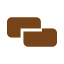

<p></p>

# Fides

**Fides connects what an agreement promises to what is actually blocking it, and escalates before the notice window closes.**

Fides (FY-deez) is a Forge app for Jira, Confluence and Rovo. It is for legal, procurement, finance, ITAM/SAM and ops teams who already work in Jira and Confluence and who track vendor and SaaS agreements in a spreadsheet, a calendar reminder, or not at all.

Codegeist 2026 · Track: **Apps for Business Teams** · Bonus: **Best Agents** (`rovo:agent` + six `action` modules)

Production **3.2.0** (169 tests, `forge lint` clean; clean-install tested on a new Free site, Nov 25 2026). The private demo site is `one-atlas-wptq.atlassian.net` (board: 1 Due / 2 Upcoming / 1 On track). Live samples: Helios Payroll CLSD-35 (Due, notice-by 2026-11-24, end 2026-12-24, blocker CLSD-39, escalation CLSD-40, review CLSD-41), Northwind Analytics CLSD-36 (notice-by 2027-01-02), Larkspur Facilities CLSD-37 (notice-by 2026-12-13, review CLSD-45), Quay Support CLSD-38 (notice-by 2027-03-18). Highest key: CLSD-45. Judges install from the Sharing link (see Devpost) and get their own issue keys.

> Fides tracks dates and obligations; it is not legal advice.

## What it does

- Each vendor agreement is a **Jira issue** (labelled `fides-agreement`), linked to its **Confluence contract page**, with structured end date, notice period, spend, owner and key obligations.
- Fides computes the **notice-by date** (end date minus notice period) and shows a **notice board** with three labelled statuses:
  - **Due**: notice-by within 14 days, today, or already past (filled diamond).
  - **Upcoming**: 15 to 60 days (half-filled square).
  - **On track**: more than 60 days (empty ring).
- A **blocker** is a linked Jira issue for an open question, a pending approval or an unmet deliverable (labelled `fides-blocker`). If a blocker is still open while the notice-by or milestone date is Due, Fides creates **exactly one escalation issue** for that agreement and blocker. It links the agreement, the blocker and the contract page, and says in hedged words that the blocker "may put the notice date of DD MMM at risk".
- A daily `scheduledTrigger` (running with `api.asApp()`) opens review issues when the notice window starts, pings them when the date is reached, and runs the escalation rule. Errors are caught and the last run is shown on the board.
- A **Rovo agent with actions** does the work in chat, as the current user and with their permissions.

## What it is not

Not a CLM, not a contract-approval router, not a jargon translator, not a budget dashboard. No document upload or PDF extraction. Spend is shown for context only.

## Rovo agent: one real question, six actions

Ask Fides **"Is Helios at risk, and what should I do?"** (a conversation starter, and the first button on the board). As the current user, the agent chains the existing actions on its own:

1. **List upcoming notices** (`list-upcoming-notices`): finds Helios Payroll as Due, with its computed notice-by (end date minus notice period), its open blocker and its escalation, and whether an open review already exists.
2. Inspects the open blocker ("Approval pending: finance sign-off ...").
3. **Create or reuse escalation** (`escalate-threatened-milestones`) for Helios: idempotent, so it reports the existing escalation issue instead of creating another.
4. **Draft renew or cancel brief** (`draft-brief`) for Helios: reads the Confluence contract page as the user.
5. Answers with the risk, why a date reminder is not enough, the escalation key, hedged renew / cancel / renegotiate options, what a missed notice could mean, and the not-legal-advice line.

The board's **Ask Fides in Rovo** panel, directly under the Due spotlight, opens Rovo Chat with that question plus ready prompts for the everyday actions (list, review, escalate, brief); track-from-page is asked for in Rovo itself.

| Action key | Confirm-card name | Verb | What it does |
| --- | --- | --- | --- |
| `list-upcoming-notices` | List upcoming notices | `GET` | Lists agreements that are Due or fall within the next N days (default 60), most urgent first, using the same rule as the board. Only issues the user can see. Includes open review and escalation keys so the agent can say, before any CREATE confirm card, whether confirming will reuse or create. |
| `create-review-issue` | Create or reuse review issue | `CREATE` | Creates (or returns the open) review issue for one agreement on the **current** site, linked to the agreement. No hardcoded IDs. Never duplicates. |
| `escalate-threatened-milestones` | Create or reuse escalation | `CREATE` | Applies the escalation rule to one or all agreements. Idempotent: reports existing escalations instead of duplicating them. |
| `draft-brief` | Draft renew or cancel brief | `GET` | Gathers a hedged renew / cancel / renegotiate brief: timing, open blockers, options, what a missed notice could mean, and quoted excerpts from the linked Confluence page read **as the user**. It cites its source ("Source: Fides sample contract: Helios Payroll (link)"); if the page cannot be read, the source line says so explicitly and why. |
| `check-agreement-from-page` | Check contract page | `GET` | The read-only first step of "track this contract": reads the Confluence page as the user and answers either "already tracked as CLSD-35" or a proposal with quoted sources. It creates and writes nothing, and being a read action Rovo runs it without a confirmation card. |
| `track-agreement-from-page` | Track agreement from page | `CREATE` | "Track this contract" or "add Helios from its page": reads the Confluence page **as the user** and proposes vendor, end date, notice period, owner and up to 3 obligations, each with the quoted sentence it came from and a confidence. Parsing is deterministic (tables, date formats, "30 days' written notice", "notice of 60 days"); the agent fills gaps from its own reading. Nothing is created until the user confirms (`confirm: true`); with `confirm: false` it writes nothing at all. On an already-tracked sample page whose dates lag Jira, confirming also updates the page in place. The rewrite is made by the Fides app, which created the sample pages, so a user who can read but not edit them is not blocked; reads stay with the signed-in user, and only pages titled "Fides sample contract: ..." that belong to a sample agreement are ever written. One agreement per page: asking again returns the existing one. An unreadable page gets "I cannot read this page". |

Agreements are resolved **by name first** (exact, then contained, then fuzzy with a one-letter typo allowed), and by issue key only as a fallback, so a nearby or guessed key never wins over the vendor the user named. Ambiguous names return the candidates instead of a guess, and every reply confirms the resolved key, for example "Resolved "Northwind Analytics" to CLSD-36 Northwind Analytics (matched by exact name)."

The agent prompt (`static/agent/prompt.txt`) tells it to use only action data, hedge every statement, use the word "blocker" for open questions, approvals and deliverables, and end decision answers with the not-legal-advice line.

## How it maps to the judging criteria

| Criterion (20% each) | How Fides meets it | Atlassian features used |
| --- | --- | --- |
| **Technological Implementation** | A real loop, not a single demo path: structured agreements, a shared status rule used by the board, scan and agent, idempotent escalation (KVS `FAIL_IF_EXISTS` claims plus Jira label guards), Jira issue properties and labels as the source of truth with KVS as a per-install cache, install-time and first-open seeding with a lock, permission-aware reads via bulk fetch, a deterministic contract-page parser, a validated 100-row import through the same create path as the form, owner notification with a three-step fallback, and a per-user snapshot for fast first paint. 163 tests in CI. | **Forge modules**: `jira:globalPage`, `jira:issuePanel`, `scheduledTrigger` (interval `day`, `api.asApp()`), `trigger` on `avi:forge:installed:app`, Key-Value Store (`@forge/kvs`). **Jira issues and links**: agreements, blockers, review and escalation issues, issue links, remote links. |
| **Design** | Native UI Kit, ADS tokens, light and dark themes, colourblind-safe chips (shape plus label), 30/60/90 grouping, last-scan status, one Fides Umber accent. Every edge state is one plain sentence and one next step. The board paints from a cached snapshot ("Updated 4m ago, refreshing") and swaps in fresh data without a layout jump. Import shows a preview with per-row errors before anything is created. | UI Kit (`render: native`, `UserPicker`, `DynamicTable`), ADS tokens, Rovo bridge `rovo.open` from the board. |
| **Potential Impact** | Missed notice periods and auto-renewals are a named cause of value leakage (see Evidence). Fides puts the date, the obligation and the blocker in the tools these teams already use, and acts before the window closes. Teams get started fast: paste their existing spreadsheet, or track a contract straight from its Confluence page. The owner hears about it through Jira itself: review and escalation issues are assigned to them and they are added as a watcher. | **Jira issues** as the system of record (assignee and watchers drive Jira's own notifications), **Confluence contract pages** as the source of terms. |
| **Innovation / Idea** | Connects contract dates to live work: an open blocker issue threatening a notice date triggers a hedged escalation automatically and through the agent. The agent can also turn a contract page into a tracked agreement, quoting each clause it relied on. | **Rovo agent + actions**: `rovo:agent` with six `action` modules: List upcoming notices, Create or reuse review issue, Create or reuse escalation, Draft renew or cancel brief, Check contract page, Track agreement from page. **Confluence**: contract pages read as the user for the brief and for track-from-page. |
| **Presentation** | Zero-setup judge mode: install, open the board, see Due / Upcoming / On track and the escalation within 10 seconds. The demo script walks the full loop in under 5 minutes. | `trigger` (install), `jira:globalPage`, **`scheduledTrigger` with `api.asApp()`** shown via the last-scan line, Rovo Chat. |

## What the first screen shows

- **Due spotlight**: the most urgent Due agreement, its computed notice-by (on the live demo site: "Notice by 2026-11-24 = end date 2026-12-24 minus 30 days notice"; a fresh install computes dates from today), its open blocker, its single linked escalation, and the line **"A date reminder can't see that this blocker is still open."**
- **Ask Fides in Rovo** right below, above the fold.
- Then the full board, grouped by status or 30 / 60 / 90 day window. Due rows also show the notice-by arithmetic, open blockers and escalation keys.

On a cold site the board never shows a silent spinner: it reads what exists, shows **"Seeding sample agreements..."** with progress (for example "1 of 4 sample agreements created, escalation created"), and renders the Helios row and its escalation as soon as they exist, without waiting for all four.

Clean-site states, each with a clear message:

| Situation | One sentence | Next step |
| --- | --- | --- |
| No Rovo Chat on the site | "Rovo Chat is not available on this site." Board, scan and escalations keep working; Ask buttons are disabled except **List upcoming notices**, which shows the list on the board. | Ask a site admin to turn on Rovo. |
| Rovo on, but no Ask Rovo in Jira (Jira Free) | A hint under the buttons points to home.atlassian.com > Agents > Fides; **List upcoming notices** shows the list on the board. | Open Rovo from home.atlassian.com. |
| No Confluence, or a page you cannot read | "Fides cannot read Confluence contract pages here yet." / "I cannot read this page." | Connect Fides to Confluence, or use **Link a page**. |
| Non-admin user | Board works normally with your permissions. | Admin-only choices (picking the project) become "Ask a Jira admin to ...". |
| No Create issues in the Fides project | "You can view agreements but cannot create issues in OPS." Board is read-only. | Ask a Jira admin for the Create issues permission in OPS. |
| Cannot create issues anywhere (fresh site) | "Fides cannot create issues for you on this site." | Ask a Jira admin for Create issues in one project. |
| Cannot read the agreement issues | "You do not have permission to read the Fides agreement issues in Jira." | Ask a Jira admin for Browse projects permission. |
| Zero agreements | "No agreements are tracked yet." | Load the samples, import rows, or add your first agreement. |
| No Jira project at all | "There is no Jira project you can use on this site yet." | Create a project, then reload. |

## Getting agreements in

- **Import agreements** (board): paste rows from a spreadsheet, tab or comma separated, with a header row: vendor, end date (YYYY-MM-DD or DD/MM/YYYY), notice days, owner, optional Confluence page link. A preview shows per-row errors and duplicates (same vendor and end date) before anything is created; then each row reports created, skipped or failed. Up to 100 rows per paste.
- **Track from a page** (Rovo): "Track this contract" on a Confluence contract page, confirm the proposal, done.
- **Add agreement** (board): a form with a Jira user picker for the owner.

## Owners hear about it in Jira

When Fides opens a review or escalation issue, it assigns the issue to the agreement's owner and adds the owner as a watcher, so Jira's own notifications reach them. Fides sends no email of its own. The owner is resolved once, when the agreement is saved:

1. The owner picked in the form, or an Atlassian account id in the import's owner column.
2. Otherwise the agreement issue's assignee.
3. Otherwise unassigned, and the board says so with a next step.

If Jira refuses the assignee, the issue is still created and a clear warning is logged. Escalation rows show **Owner notified via Jira**. Turning an owner's email or name into an account needs Jira user search, which needs the `read:jira-user` scope; Fides does not request it, so emails and names fall back to step 2. Adding that scope later is a one-line manifest change plus an upgrade.

## Fast first paint

The board paints from your own last snapshot (one storage read, no Jira calls), Due spotlight first, with "Updated Xm ago, refreshing" in the header, then swaps in fresh data without moving the layout. Snapshots are per user, so a cached paint never shows an issue you cannot open. On a brand-new install there is no snapshot: the seeding progress shows and rows appear as soon as they exist. Each open logs "Fides first useful paint: N ms" in the Forge logs. Targets: under 3 s warm, under 10 s cold.

## Judge setup (fresh site, zero manual steps)

1. Install from the Sharing link on a site where you are an admin, for both Jira and Confluence (the link offers both).
2. Open **Apps > Fides** in Jira. Sample agreements load automatically on install or on this first open; there is no button to press. Within about ten seconds the board shows **1 Due** (Helios Payroll, with one open blocker and one escalation issue), **2 Upcoming** and **1 On track**, each linked to a sample Confluence contract page. If your Confluence has no space yet (a new Free site starts with none), Fides creates one called **Fides contracts** for the sample pages.
3. Use the **Ask Fides in Rovo** buttons on the board, or open Rovo and choose **Fides**. If Jira has no Ask Rovo button (for example on Jira Free), go to **home.atlassian.com**, choose **Agents**, then **Fides**. **List upcoming notices** also shows the list right on the board, with or without Rovo.
4. Try the six actions: **List upcoming notices**, **Create or reuse review issue**, **Create or reuse escalation**, **Draft renew or cancel brief**, **Check contract page** and **Track agreement from page**. Asking a second time for a review or an escalation reuses the open issue instead of creating a duplicate.

Two **Fides** entries in the Rovo agent picker are expected, one per product install. Both give the same answers, because Fides reads everything from Jira.

What happens underneath: judge mode seeds once per site (install trigger in the background, or the first board open, whichever is first), with dates computed from today, a review issue for the Due agreement and the escalation created immediately, not on the next daily run. Jira is the source of truth, so installing on both products, reinstalling or opening the board mid-install reuses the existing samples. Only the Confluence install trigger, the board open and the daily Confluence run create sample pages (the Jira install trigger only links existing ones, because the two installs have separate app storage and cannot share a lock). A sample page whose dates are older than Jira is rewritten in place.

5. Open the Helios Payroll sample contract page in Confluence, open Rovo there and say "Track this contract". Fides says it is **already tracked** and names the same issue key the board shows, without a confirmation card.
6. Click **Import agreements**, paste two rows from a spreadsheet, preview, import.

Notes:

- If Fides is connected to Confluence after Jira, the next board open (or the Confluence install event) links the sample agreements to their contract pages without creating duplicate pages.
- Seeding is safe to re-run and **skips when real data exists** (any `fides-agreement` issue without the `fides-sample` label, or any non-sample agreement in Fides). The **Load samples** button appears only on an empty board (for example after real data made seeding skip); it is an explicit request and seeds anyway, still without duplicates.
- Fides picks the first project on the site where it can create a standard issue type (Task, or the site's default). If there is none, the board shows a project picker.
- Rovo must be available on the site. On Jira Free there is no Ask Rovo button in Jira: use home.atlassian.com > Agents > Fides. Classic `*-dev.atlassian.net` sites often lack Rovo; use a site from `forge site provision`.
- If the app cannot use Confluence on your site, agreements and escalations still seed and the board offers **Link a page**.

## Developer setup

Requires **Node 22.x (22.23.4 or later) or 24.x (24.22.1 or later)**, per the live Forge getting-started page.

```bash
npm install -g @forge/cli@latest
npm ci
npm test                    # 163 unit and integration tests
node scripts/copy-lint.mjs  # copy rules (also runs in npm test)
npm run validate:manifest   # offline schema check with @forge/manifest
```

With `FORGE_EMAIL` and `FORGE_API_TOKEN` set in the environment (do not run `forge login` then, and never echo the token):

```bash
forge register              # first time only; replaces the placeholder app.id
forge deploy
forge install --demo-site
```

**After adding or changing scopes**, run `forge deploy` and then `forge install --upgrade` so the site grants the new scopes.

The full deploy, provisioning, Sharing and submission checklist is in [`docs/HANDOFF.md`](docs/HANDOFF.md).

## Architecture

```
manifest.yml
src/
  index.js            Forge handlers: UI resolver, install trigger, daily scan, 6 Rovo actions
  services.js         Core loop: agreements, blockers, review issues, escalation, scan, judge mode, board data
  lib/dates.js        Notice-by and Due / Upcoming / On track rules (single source of truth)
  lib/escalation.js   Blocker open check, RED window, idempotency keys, hedged wording
  lib/samples.js      Judge-mode sample agreements relative to today
  lib/brief.js        Hedged brief drafting and assistive page excerpts
  lib/atlassian.js    Documented Jira REST v3 and Confluence REST v2 calls
  lib/store.js        KVS layout and claims
  lib/match.js        Name-first agreement matching for Rovo actions
  lib/extract.js      Deterministic contract-page parsing for track-from-page
  lib/importRows.js   Paste-rows import parsing and validation
  lib/view.js         Pure board view model: seeding, spotlight and clean-site states
  frontend/board.jsx  Notice board (jira:globalPage, UI Kit)
  frontend/panel.jsx  Issue panel (jira:issuePanel, UI Kit)
static/               Agent prompt and icon
test/                 node:test suites, including an offline judge-mode acceptance test
scripts/              Manifest validation and a live acceptance poll
```

- People-facing paths (board, panel, Rovo actions) use `api.asUser()`, so they respect Jira and Confluence permissions.
- Scheduled and install work uses `api.asApp()`, because scheduled triggers have no user.
- Agreement issues in Jira are the source of truth: the `fides-agreement` issue property plus labels (`fides-agreement`, `fides-escalation`, `fides-review`, `fides-blocker`). The Forge Key-Value Store is a per-install cache hydrated from Jira; an empty store must never mean "no agreements". No custom issue type or custom field is needed. No external hosting.

## Scopes

| Scope | Why |
| --- | --- |
| `read:jira-work` | Read agreements, blockers, links; search; bulk fetch |
| `write:jira-work` | Create agreement, blocker, review and escalation issues; links; comments |
| `storage:app` | Key-Value Store |
| `read:page:confluence` | Read the contract page for the brief; find sample pages |
| `write:page:confluence` | Create sample contract pages in judge mode |
| `read:space:confluence` | Pick a space for sample pages |
| `write:space:confluence` | Create the **Fides contracts** space when the site has no Confluence space (new Free sites) |

## Evidence

Only these figures are cited:

- World Commerce & Contracting with Ironclad, *Closing the Procurement Value Gap* (2026): organisations lose an average of **11% of contract value** after signature. The report names auto-renewals at unfavourable terms and missed notice periods among the causes. Caveat: the report was produced with a CLM vendor and its methodology is not fully public. Sources: [report PDF](https://www.worldcc.com/static/88fffe38-ee53-49da-904c696d0030219d/Procurement-value-gap.pdf), [landing page](https://info.worldcc.com/closing-the-procurement-value-gap).
- Flexera *2023 Tech Spend Pulse*: an estimated **21% of SaaS spend wasted**. Flexera *State of IT Asset Management* (Oct 2022): only **43%** of SAM teams tracked and managed SaaS auto-renewal clauses.

## Acceptance

- [x] `docs/SDK-NOTES.md` pins Node, CLI and runtime from live docs and names official module keys (no invented keys).
- [x] `forge deploy` succeeds (deployed by Fluid).
- [x] `forge install --demo-site` succeeds (installed on the demo site).
- [x] Load samples / judge mode seeds the current site (Due, Upcoming, On track) with no hardcoded site, project or issue IDs. *(Verified offline; confirm live.)*
- [x] Notice board shows Due / Upcoming / On track with shapes and labels, 30/60/90 grouping, last-scan status and the footer. *(Built; confirm live.)*
- [x] Issue panel shows status on agreement, review, blocker and escalation issues. *(Built; confirm live.)*
- [x] Rovo agent is visible in Rovo Chat.
- [x] `list-upcoming-notices` returns the samples.
- [ ] `create-review-issue` creates a real Jira issue on the current site. **Pending live site.**
- [ ] `escalate-threatened-milestones` reports the judge-mode escalation and never duplicates. **Pending live site.**
- [ ] `draft-brief` is permission-aware and uses the linked page when readable. **Pending live site.**
- [x] Daily `scheduledTrigger` (`interval: day`) is in the manifest and wired; errors are caught; last run is visible.
- [x] Unit tests for date and status rules, the RED window, blocker open/closed and idempotency pass in CI.
- [ ] Judge mode: seeded board plus escalation visible within 10 seconds of **opening the board** after a fresh install. First live run: board in 8.8 s with all four agreements and the escalation; rerun the official check (`docs/HANDOFF.md` step 8A) after the latest redeploy. Install-time seeding is best effort (it waits for app permissions, 47 s on the first run).
- [x] Sample agreements link to their Confluence contract pages, including on a new Free site with no Confluence space (verified on a clean site, Nov 25 2026).
- [ ] `track-agreement-from-page` proposes with quoted sources, creates only on confirm, and returns the existing agreement on a second run. **Tested offline; confirm live (HANDOFF 8G).**
- [ ] Import agreements: preview with per-row errors, duplicates skipped, created / skipped / failed per row. **Tested offline; confirm live.**
- [ ] Review and escalation issues assigned to the owner (or agreement assignee), owner added as watcher, "Owner notified via Jira" on the board. **Tested offline; confirm live.**
- [ ] Warm board paints from the snapshot in under 3 s; cold under 10 s (see "Fides first useful paint" in the Forge logs). **Confirm live.**
- [x] Every edge state shows one sentence and one next step (tests per state).
- [x] Copy lint clean (`node scripts/copy-lint.mjs`, also in `npm test`).
- [ ] Samples created exactly once per site across Jira + Confluence installs, reinstalls and concurrent runs. **Fixed and tested offline after the live duplicate finding; confirm live (HANDOFF 8H).**
- [x] README, LICENSE (Apache-2.0), DEMO-SCRIPT.md, SUBMISSION-DRAFT.md, docs/HANDOFF.md, docs/COLOR-THEME.md present.
- [x] No API tokens or debug credentials in git.
- [x] Repo left private. No Devpost submission. No video upload.

## License

Apache-2.0. See [LICENSE](LICENSE).

---

Fides tracks dates and obligations; it is not legal advice.
